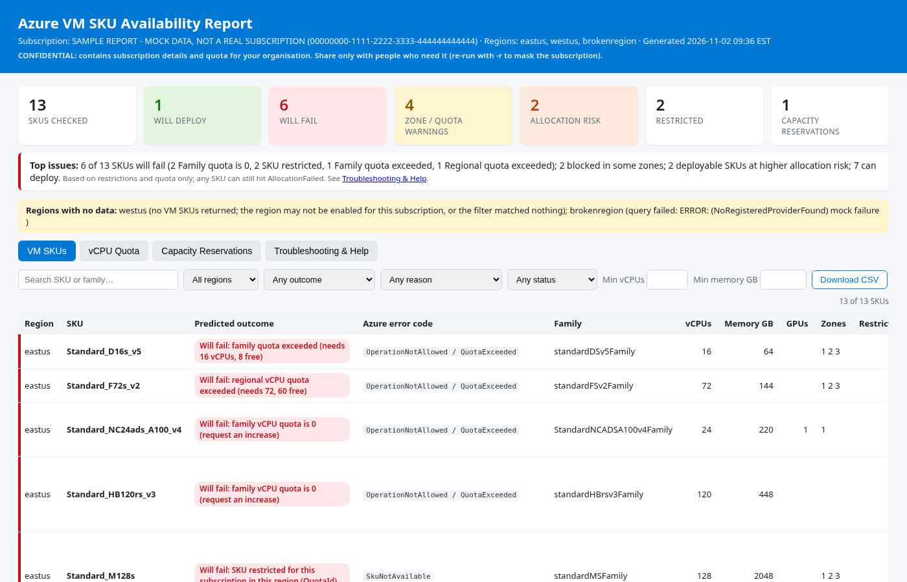
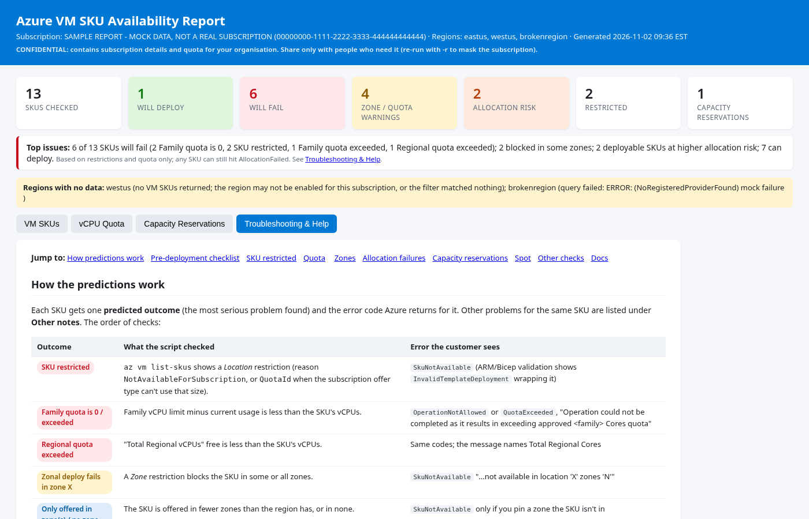

# Azure VM SKU Availability Report

`azure-vm-sku-report.sh` is a single Bash script that tells you **which Azure VM sizes (SKUs) a subscription can deploy,
which will fail, and why**. For every SKU in the regions you choose, it checks:

- **SKU restrictions** for the subscription (region-wide and per availability zone),
- **vCPU quota**: the VM-family quota and the Total Regional vCPUs quota,
- **zone support** (sizes offered only in some zones, or none),
- **allocation-risk heuristics** (GPU, HPC, M-series, legacy and very large sizes),
- **capacity reservations** already in the subscription.

It writes **one self-contained HTML file** that works offline and has no external dependencies. The file contains a
sortable, filterable SKU table, a predicted outcome for each SKU with the Azure error code the customer would see, a vCPU
quota view, capacity reservations, and a *Troubleshooting & Help* tab that explains how to fix each kind of failure.

> The script is **read-only**. It never creates, changes or deletes Azure resources, and it doesn't change your default
> `az` subscription.



---

## Contents
- [Prerequisites](#prerequisites)
- [Required permissions](#required-permissions)
- [Install](#install)
- [Usage](#usage)
- [Viewing the report](#viewing-the-report)
- [The report, tab by tab](#the-report-tab-by-tab)
- [How predictions are computed](#how-predictions-are-computed)
- [Troubleshooting flow](#troubleshooting-flow)
- [Security and data handling](#security-and-data-handling)
- [Testing](#testing)
- [Known limitations](#known-limitations)
- [Changelog](#changelog)

## Prerequisites

| Requirement | Notes |
|---|---|
| **Bash 4.4+** | Linux, macOS (install a newer bash with Homebrew), WSL, or Azure Cloud Shell |
| **Azure CLI** (`az`) | Signed in with `az login`. Any recent 2.x version. Newer versions return quota numbers as strings, which the script handles. |
| **jq** 1.6+ | JSON processing |
| **openssl** (optional) | Builds the Content-Security-Policy hash. Without it the CSP falls back to `'unsafe-inline'`. |

**Azure Cloud Shell (Bash)** already has all of these and is already signed in, so it's the easiest place to run the
script.

## Required permissions

The script only reads data. The built-in **Reader** role on the subscription is enough. With the minimum permissions below,
the corresponding parts of the report are filled in:

| Action | Used for |
|---|---|
| `Microsoft.Resources/subscriptions/read` | Subscription name and ID |
| `Microsoft.Resources/subscriptions/locations/read` | Region list when `-l` is omitted |
| `Microsoft.Compute/skus/read` | `az vm list-skus` (sizes, zones, restrictions) |
| `Microsoft.Compute/locations/usages/read` | `az vm list-usage` (vCPU quota) |
| `Microsoft.Compute/capacityReservationGroups/read`, `.../capacityReservations/read` | Capacity reservations tab (skip with `-x`) |

Example custom role:

```json
{
  "Name": "VM SKU Report Reader",
  "Description": "Read-only access for azure-vm-sku-report.sh",
  "Actions": [
    "Microsoft.Resources/subscriptions/read",
    "Microsoft.Resources/subscriptions/locations/read",
    "Microsoft.Compute/skus/read",
    "Microsoft.Compute/locations/usages/read",
    "Microsoft.Compute/capacityReservationGroups/read",
    "Microsoft.Compute/capacityReservationGroups/capacityReservations/read"
  ],
  "AssignableScopes": ["/subscriptions/<subscription-id>"]
}
```

## Install

In Cloud Shell or any Bash shell:

```bash
git clone <this-repo-url> azure-vm-sku-report && cd azure-vm-sku-report
chmod +x azure-vm-sku-report.sh
```

Or copy just the script. In Cloud Shell you can upload it with **Manage files > Upload**, then run `chmod +x`.

## Usage

```text
./azure-vm-sku-report.sh [-l "<regions>"] [-s <subscription>] [-f <regex>] [-o <file.html>] [-x] [-r] [-h]
```

| Option | Meaning | Default |
|---|---|---|
| `-l` | Regions to scan, separated by spaces or commas (for example `"eastus westeurope"`). Names as in `az account list-locations -o table`. | All physical regions (slow, large report) |
| `-s` | Subscription ID or name. Passed to each `az` call with `--subscription`; your default subscription is **not** changed. | Current `az` subscription |
| `-f` | SKU filter: a case-insensitive regex. Without an `_` it's matched against the name minus the `Standard_` prefix, so `NC\|ND` finds N-series without matching "sta**nd**ard". With an `_` it's matched against the full name (`Standard_D`). | All SKUs |
| `-o` | Output HTML file | `azure-vm-sku-report.html` |
| `-x` | Skip the capacity reservation lookup | Lookup on |
| `-r` | Redact: masks the subscription ID (keeps the last 4 characters) and name, for sharing outside your team | Off |
| `-h` | Show help | |

### Examples

```bash
# One region, current subscription
./azure-vm-sku-report.sh -l eastus

# Two regions, a specific subscription, D-series only
./azure-vm-sku-report.sh -l "eastus westeurope" -s <subscription-id> -f "Standard_D" -o d-series.html

# GPU sizes (NC / ND / NV) in three regions
./azure-vm-sku-report.sh -l "eastus,southcentralus,westus3" -f "^N" -o gpu.html

# Report you can send to a partner or Microsoft support (subscription masked, no reservation names)
./azure-vm-sku-report.sh -l eastus -r -x -o eastus-shareable.html

# Every region (takes several minutes and produces a big file)
./azure-vm-sku-report.sh -o all-regions.html
```

The script prints progress to stderr. Regions that return no data are reported but don't stop the run:

```text
Subscription: Contoso-Prod (00000000-1111-2222-3333-444444444444)
Querying eastus ...
Querying westus ...
  note: no VM SKUs returned for westus (region may not be enabled for this subscription or the filter matched nothing)
Checking capacity reservations ...
Report written to azure-vm-sku-report.html (13 SKUs, 6 predicted to fail)
```

## Viewing the report

The HTML file is self-contained and works offline in any modern browser.

- **Azure Cloud Shell:** run `download azure-vm-sku-report.html`, or use **Manage files > Download**. Then open the file on
  your PC.
- **Windows PowerShell:** `Start-Process .\azure-vm-sku-report.html`
- **macOS:** `open azure-vm-sku-report.html`. **Linux desktop:** `xdg-open azure-vm-sku-report.html`
- **Terminal only:** `w3m` or `lynx` show a text version. To print the data as a table:

```bash
sed -n '/^const D =$/,/^;$/p' azure-vm-sku-report.html | sed '1d;$d' \
 | jq -r '.skus[] | [.region,.sku,.vcpus,.memGB,.outcome,.code] | @tsv' | column -t -s $'\t' | less -S
```

A sample report built from **mock data** is in [`docs/sample-report.html`](docs/sample-report.html).

## The report, tab by tab

**Header:** subscription, regions, filter, generation time and a *CONFIDENTIAL* notice.
**Cards:** SKUs checked, will deploy, will fail, zone/quota warnings, allocation risk, restricted, capacity reservations.
**Top issues:** a one-line summary, for example *"6 of 13 SKUs will fail (2 Family quota is 0, 2 SKU restricted, 1 Family
quota exceeded, 1 Regional quota exceeded); 2 blocked in some zones; 2 deployable SKUs at higher allocation risk; 7 can
deploy."*
**Regions with no data:** a yellow banner lists regions that returned nothing or whose query failed.

### VM SKUs tab
Filters: text search (SKU or family), region, **outcome** (Will fail / Warning / Allocation risk / Deploys with zone notes /
Will deploy / Deployable), **reason**, restriction status, minimum vCPUs and minimum memory. Click a column header to sort.
**Download CSV** exports every matching row, with formula-injection protection. The table shows up to 2,000 rows at a time;
narrow it with the filters.

| Column | Meaning |
|---|---|
| Region, SKU, Family | Size name and its quota family (for example `standardDSv5Family`) |
| **Predicted outcome** | The most serious problem found, colour-coded. Click it to open the matching help topic. |
| **Azure error code** | The error the customer would get for that outcome |
| vCPUs, Memory GB, GPUs | From the SKU capabilities |
| Zones | Zones where the size is offered in this region (empty = no zone support) |
| Restricted zones | Zones blocked for this subscription |
| Status | `Available`, `PartiallyAvailable` (blocked in some zones) or `NotAvailable` (blocked in the region) |
| Family used / limit / free | VM-family vCPU quota |
| Regional free | Free "Total Regional vCPUs" |
| Max VMs (quota) | How many VMs of this size fit in the smaller of the two quotas (– when restricted) |
| Can deploy 1 | `Yes`, `No (quota)`, `No (restricted)` or `Unknown` (family not in the usage list) |
| Restriction reason | `NotAvailableForSubscription` or `QuotaId` |
| Other notes | Further issues for the same SKU, plus "Gen2 images only" and "No accelerated networking" |

Row colours: red = will fail, amber = warning, orange = allocation risk, blue = deploys with zone notes, green = will deploy.

### vCPU Quota tab
Every quota row from `az vm list-usage` for each region: used, limit, free and a usage bar (red at 80% or more). Limit-0
rows say **"limit 0 – request increase"**. Filters: *Only in use*, *Only limit 0*, and *Only families in SKU list* (hides
unrelated families).

### Capacity Reservations tab
Capacity reservation groups and reservations in the subscription: group, resource group, reservation, region, SKU, reserved
count and zones. Check usage with `az capacity reservation show ... --instance-view`.

### Troubleshooting & Help tab
How predictions work, a pre-deployment checklist with commands filled in from the report, and confirm/fix steps for each
failure type (summarised [below](#troubleshooting-flow)), with links to Microsoft Learn.



Full help tab: [docs/report-help-tab-full.png](docs/report-help-tab-full.png)

## How predictions are computed

For each SKU, the script collects every issue that applies, sorts them by priority, and shows the first one as the
**Predicted outcome**. The rest go to *Other notes*.

| Priority | Outcome | Rule | Error the customer sees |
|---|---|---|---|
| 1 | **Will fail: SKU restricted** | A `Location` restriction in `az vm list-skus --all` (reason `NotAvailableForSubscription`, or `QuotaId` for offer types that can't use the size) | `SkuNotAvailable` (`InvalidTemplateDeployment` for ARM/Bicep validation) |
| 2 | **Will fail: family quota is 0** | Family limit = 0 | `OperationNotAllowed` / `QuotaExceeded` |
| 3 | **Will fail: family quota exceeded** | Family limit − used < SKU vCPUs | `OperationNotAllowed` / `QuotaExceeded` |
| 4 | **Will fail: regional quota exceeded** | Total Regional vCPUs free < SKU vCPUs | `OperationNotAllowed` / `QuotaExceeded` |
| 5 | **Zonal deploy fails in zone(s) X** | A `Zone` restriction on some or all zones | `SkuNotAvailable` when that zone is pinned |
| 6 | **Quota unknown** | Family not in `az vm list-usage`, or usage returned nothing | — |
| 7 | **Allocation risk: high / medium** | High: GPU (N-series or GPUs > 0), HPC (H-series), M-series, legacy (Av1, Dv1, DSv1, D15_v2, G). Medium: 64+ vCPUs or 512+ GB, or offered in only one zone. | Possible `AllocationFailed`, `ZonalAllocationFailed`, `OverconstrainedAllocationRequest`, `OverconstrainedZonalAllocationRequest` |
| 8 | **Quota tight** | Only 1–2 VMs of the size fit | Quota errors when scaling out |
| 9 | **Will deploy. Only offered in zone(s) … / no zone support** | Size offered in fewer zones than the region has, or none | `SkuNotAvailable` only if a zone it isn't in is pinned |
| – | **Will deploy** | No restriction, and at least one VM fits in both quotas | None expected |

**Limits of the prediction:**
- Azure publishes **no data on free physical capacity**. "Will deploy" means the restriction and quota checks pass. It
  doesn't guarantee the deployment will be allocated. Only a capacity reservation guarantees that.
- Allocation risk is a **heuristic**, not a measurement.
- Quota is checked for **one VM** of the size ("Max VMs" shows how many fit). Deploying several VMs, or other VMs in the
  same family, uses the same quota.
- Spot VMs use a separate low-priority quota that isn't evaluated.
- Other deployment-time checks are only noted, not evaluated: image generation (Gen1/Gen2), accelerated networking, disk
  types (UltraSSD / Premium SSD v2), proximity placement groups, dedicated hosts, and Azure Policy denies.
- The report is a point-in-time snapshot. Quota and restrictions change, so re-run it before large deployments.

## Troubleshooting flow

```text
Deployment failed?
 ├─ SkuNotAvailable / InvalidTemplateDeployment ─► SKU restricted (region or zone) or not offered in that zone
 ├─ OperationNotAllowed / QuotaExceeded ─────────► family or regional vCPU quota
 ├─ AllocationFailed / ZonalAllocationFailed ────► no capacity right now
 └─ OverconstrainedAllocationRequest / OverconstrainedZonalAllocationRequest ─► too many placement constraints
```

### `SkuNotAvailable`: SKU restricted
- **Confirm:** `az vm list-skus --location <region> --size <size> --all -o table`. Check the *Restrictions* column (type
  `Location` or `Zone`, the reason and the zones).
- **Fix:** choose another size or region (filter the report on *Will deploy*). Or ask Azure Support to enable it: portal >
  **Help + support > Create a support request**, issue type **Service and subscription limits (quotas)**, quota type
  **Compute-VM (cores-vCPUs) subscription limit increases**, then the region and VM series. For `QuotaId`, the subscription
  offer type (for example a free trial) can't use the size, so use a different offer or subscription.

### `OperationNotAllowed` / `QuotaExceeded`: vCPU quota
- **Confirm:** `az vm list-usage --location <region> -o table`. A VM must fit in **both** the family quota and Total
  Regional vCPUs.
- **Fix:** portal **Quotas > Compute** (or *Subscription > Usage + quotas*) **> New Quota Request**. Many requests are
  approved automatically within minutes. CLI, with the `quota` extension:
  ```bash
  az extension add --name quota
  SCOPE=/subscriptions/<sub-id>/providers/Microsoft.Compute/locations/<region>
  az quota list   --scope $SCOPE -o table
  az quota update --resource-name standardDSv5Family --scope $SCOPE --limit-object value=<new-limit> --resource-type dedicated
  ```
  Or free quota: deallocated VMs don't count toward vCPU quota, but VMs that are only *stopped* do.

### Zone restrictions and zone-pinned sizes
- Use a zone listed as OK in the outcome, or deploy without a zone. Choose sizes offered in every zone you need for a
  zone-redundant design.
- Zone numbers are mapped per subscription, so run the report for each subscription.

### `AllocationFailed`, `ZonalAllocationFailed`, `Overconstrained*`: no capacity
1. Retry later.
2. Try another size, ideally a newer generation or another size in the same family.
3. Try another zone or no zone, then another region.
4. Remove constraints: accelerated networking, proximity placement group, UltraSSD or Premium SSD v2.
5. Availability set: deallocate **all** VMs in the set, then start them together. Proximity placement group: deallocate all
   VMs, then start the most restrictive size first.
6. Move legacy sizes (Av1, Dv1, DSv1, D15_v2, G) to current ones.
7. To **guarantee** capacity, create an **on-demand capacity reservation**. It's billed whether or not it's used, and
   creating it can itself fail if there's no capacity.
8. **Spot isn't a fix.** Spot VMs use spare capacity and are evicted first when a region is short.

Microsoft Learn:
[SKU not available](https://learn.microsoft.com/en-us/azure/azure-resource-manager/troubleshooting/error-sku-not-available) ·
[Resource quota errors](https://learn.microsoft.com/en-us/azure/azure-resource-manager/troubleshooting/error-resource-quota) ·
[Increase VM-family quota](https://learn.microsoft.com/en-us/azure/quotas/per-vm-quota-requests) ·
[Increase regional quota](https://learn.microsoft.com/en-us/azure/quotas/regional-quota-requests) ·
[Allocation failures](https://learn.microsoft.com/en-us/troubleshoot/azure/virtual-machines/windows/allocation-failure) ·
[Capacity reservation](https://learn.microsoft.com/en-us/azure/virtual-machines/capacity-reservation-overview) ·
[az quota](https://learn.microsoft.com/en-us/cli/azure/quota)

## Security and data handling

See [SECURITY_REVIEW.md](SECURITY_REVIEW.md) for the full review. In short:

- **Read-only.** Only `list`/`show` commands are run, and `az account set` isn't used.
- **The report is confidential.** It contains the subscription ID and name, quota and reservation names. It's written with
  mode `0600` and marked CONFIDENTIAL. Use `-r` (and `-x`) before sharing it. **Don't commit real reports**:
  `.gitignore` ignores `*.html` except `docs/`.
- **Safe HTML.** All data is escaped, JSON is embedded with `<`, `>` and `&` escaped, and a Content-Security-Policy allows
  only the report's own script, with no network access.
- **Safe CSV.** Cells starting with `= + - @` are prefixed with `'`.
- **Validated inputs.** Region names, subscription, regex and output path are checked before any Azure call.

## Testing

`test/mock-az` is a fake Azure CLI with test data covering:
- quota exceeded (family, regional, limit 0),
- zone restrictions (partial and all zones),
- zone-pinned and zone-less sizes,
- a family missing from usage,
- restricted SKUs (`NotAvailableForSubscription`, `QuotaId`),
- GPU, HPC, M-series and legacy sizes,
- an empty region and a failing region.

`MOCK_EVIL=1` switches to malicious data (HTML, script, quote and CSV-formula payloads). `MOCK_LOG=<file>` records every
call.

```bash
test/run-tests.sh                       # 13 checks: counts, permissions, read-only calls, XSS, CSP, input validation, redaction

# Build a report from the mock by hand
mkdir -p /tmp/mockbin && ln -sf "$PWD/test/mock-az" /tmp/mockbin/az
PATH=/tmp/mockbin:$PATH ./azure-vm-sku-report.sh -l "eastus westus" -o /tmp/mock.html
```

The screenshots in `docs/` were made with headless Chrome:
`google-chrome --headless --no-sandbox --window-size=1400,900 --screenshot=... docs/sample-report.html`
(add `#tab-help` to the URL to open the help tab).

## Known limitations

- No free-capacity data exists, so `AllocationFailed` can't be predicted, only flagged as a risk.
- For a size restricted in **all** zones, the report says a non-zonal deploy *may* still work. A Zone-type restriction is
  understood to block only zone-pinned deployments, but confirm with a test deployment or `az deployment group validate`.
- The quota error code varies by API version and tool: Microsoft docs show `OperationNotAllowed`, while the CLI and portal
  often show `QuotaExceeded`.
- For `az quota`, the Total Regional vCPUs resource name is usually `cores`. Check it with `az quota list` first.
- SKU families are matched to quota rows by name (case-insensitive). A family whose name differs from its usage row shows
  as "Quota unknown".
- Scanning every region can take 10+ minutes and produce a large file. The table renders at most 2,000 rows at a time.
- `az account list-locations` has no `--subscription` option, so when `-l` is omitted the region list comes from your
  default subscription. Region names are the same everywhere, but a region enabled only on the target subscription may be
  missed. Pass `-l` to be sure.
- Spot quota, dedicated hosts, Azure Policy and image compatibility aren't evaluated.

## Changelog

### 1.2.0 (2026-11-02): security hardening
- `-s` is passed with `--subscription` on every call. `az account set` is no longer used.
- New `-r` option redacts the subscription. A CONFIDENTIAL banner was added, and the report and temp files are owner-only
  (`umask 077`, `chmod 600`).
- JSON embedded with `<`, `>` and `&` escaped. `esc()` also escapes `'`. A Content-Security-Policy (script hash,
  `default-src 'none'`) plus `no-referrer` and `noindex` were added.
- CSV formula-injection protection and CRLF line endings.
- Input validation for `-l`, `-s`, `-f` and `-o`. Region and reservation lists no longer glob or word-split.
- Copy-paste commands in the help tab use only safe characters. Temp-dir cleanup on INT/TERM.
- Added `test/run-tests.sh`, plus malicious-data and call-logging modes in `test/mock-az`.

### 1.1.0 (2026-11-02): predictions and help
- Per-SKU **Predicted outcome** with the Azure error code, severity colours and outcome/reason filters.
- **Top issues** summary, and a **Troubleshooting & Help** tab with Microsoft Learn links.
- Fixes:
  - Restricted SKUs no longer show Max VMs.
  - Limit-0 quotas are now shown.
  - A missing family shows "Unknown" instead of "Yes".
  - Zone restrictions and zone-pinned or zone-less sizes are detected.
  - Negative free quota is clamped.
  - Empty and failed regions are reported.
  - Large reports are capped at 2,000 rendered rows.
  - The `-f "NC|ND"` filter no longer matches "Standard".

### 1.0.1: string quota fix
- Newer Azure CLI versions return `currentValue`/`limit` as strings. These are converted with `tonumber` (fixes `jq: string
  ("20") and string ("0") cannot be subtracted`).

### 1.0.0: initial version
- Single-file HTML report: SKU availability, vCPU quota and capacity reservations.
