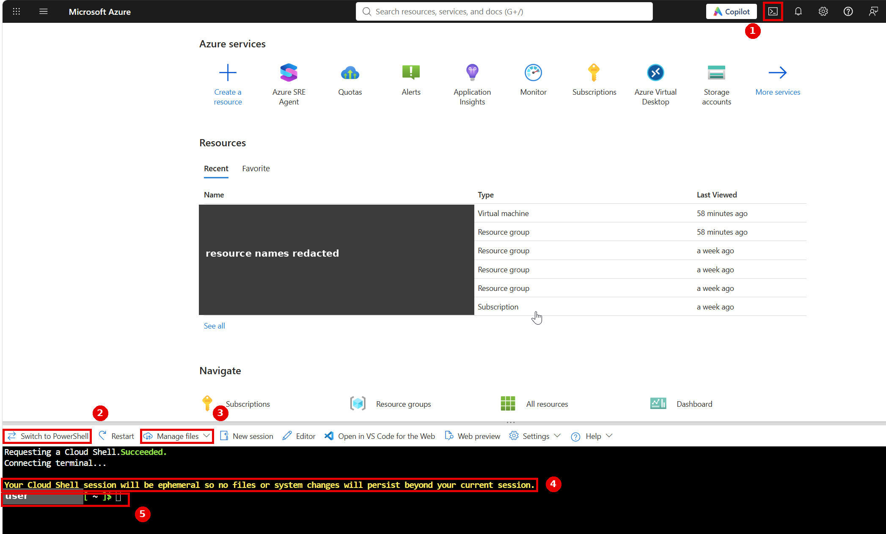

# Getting started

This guide takes you from nothing to your first report, step by step. It's written for someone who hasn't used the Azure
CLI or this script before. Everything here matches `azure-vm-sku-report.sh` **v1.2.0**. Run `./azure-vm-sku-report.sh -h`
to see the same options.

**In short:** open Azure Cloud Shell (Bash), upload or clone the script, run
`./azure-vm-sku-report.sh -l eastus`, then download the HTML file and open it in your browser. You need the **Reader**
role on the subscription, nothing more.

- [1. Choose where to run it](#1-choose-where-to-run-it)
- [2. Open Azure Cloud Shell (recommended)](#2-open-azure-cloud-shell-recommended)
- [3. Get the script](#3-get-the-script)
- [4. Sign in and choose the subscription](#4-sign-in-and-choose-the-subscription)
- [5. Run it](#5-run-it)
- [6. View the report](#6-view-the-report)
- [7. Permissions](#7-permissions)
- [8. Troubleshooting the script](#8-troubleshooting-the-script)
- [9. FAQ](#9-faq)

---

## 1. Choose where to run it

The script is a **Bash** script. It needs **Azure CLI** (`az`), **jq** and Bash 4.4 or later. `openssl` is optional and is
used for the page's security policy.

| Where | What to install | Notes |
|---|---|---|
| **Azure Cloud Shell (Bash)**, recommended | Nothing | `az`, `jq`, `git` and `openssl` are already installed, and you're already signed in. |
| **Linux** or **macOS** | Azure CLI + jq | See below. macOS ships Bash 3.2, which is too old, so install a newer one. |
| **Windows** | WSL (recommended) or Git Bash, plus Azure CLI + jq | **Native PowerShell or cmd can't run it.** It's a Bash script. |

### Linux (Ubuntu / Debian)
```bash
curl -sL https://aka.ms/InstallAzureCLIDeb | sudo bash     # Azure CLI (Microsoft's install script)
sudo apt-get update && sudo apt-get install -y jq
```
For RHEL / Fedora / SUSE, follow [Install the Azure CLI on Linux](https://learn.microsoft.com/en-us/cli/azure/install-azure-cli-linux),
then `sudo dnf install -y jq` (or `sudo zypper install jq`).

### macOS (Homebrew)
```bash
brew update && brew install azure-cli
brew install jq bash          # bash: macOS's built-in /bin/bash 3.2 is too old
bash --version                # should be 5.x. If not, run the script as:  "$(brew --prefix)/bin/bash" ./azure-vm-sku-report.sh ...
```

### Windows: WSL (recommended)
In PowerShell **as administrator**, run `wsl --install`, restart, and open **Ubuntu**. Then follow the Linux steps above
inside Ubuntu. WSL has its own Azure CLI sign-in, separate from Windows.

### Windows: Git Bash
Install [Git for Windows](https://git-scm.com/download/win) (includes Git Bash and openssl), then in PowerShell:
```powershell
winget install --exact --id Microsoft.AzureCLI
winget install --exact --id jqlang.jq
```
Close and reopen Git Bash so it finds `az` and `jq`. Git Bash works, but it's less tested than Cloud Shell, Linux or WSL.
When you copy `az quota` commands that contain `--scope /subscriptions/...` from the report's help tab, put
`MSYS_NO_PATHCONV=1` before them so Git Bash doesn't rewrite the path.

---

## 2. Open Azure Cloud Shell (recommended)



*Azure portal with Cloud Shell open in Bash. Resource names and the user name are redacted.*

1. Sign in at **<https://portal.azure.com>** with an account that can read the subscription you want to check.
2. Click the **Cloud Shell** icon **(1)**, the `>_` button in the top bar to the left of the bell.
3. The first time, choose **Bash**. When asked about storage, you can choose **No storage account required**. That gives
   an *ephemeral* session.
4. Check that Bash is active: the toolbar button reads **Switch to PowerShell (2)**. If it reads *Switch to Bash*, click it.
5. The **Manage files (3)** menu has **Upload** and **Download**. Use them to put the script into Cloud Shell and get the
   report out.
6. Note the yellow warning **(4)**: *"Your Cloud Shell session will be ephemeral so no files or system changes will persist
   beyond your current session."* Files are deleted shortly after you close the window or restart Cloud Shell, and the
   session also ends after 20 minutes without input. **Download the report before you close Cloud Shell.** If you want
   files to stay between sessions, set Cloud Shell up with a storage account instead (see
   [Persist files in Cloud Shell](https://learn.microsoft.com/en-us/azure/cloud-shell/persisting-shell-storage)).
7. The prompt **(5)** (`<user> [ ~ ]$`) means you're in your home directory (`/home/<user>`) and ready to type commands.

> The first time you use Cloud Shell in a subscription, the `Microsoft.CloudShell` resource provider may need to be
> registered. See [Get started with ephemeral sessions](https://learn.microsoft.com/en-us/azure/cloud-shell/get-started/ephemeral).

---

## 3. Get the script

**Option A: git clone** (Cloud Shell, Linux, macOS, WSL, Git Bash):
```bash
git clone <repo-url> azure-vm-sku-report
cd azure-vm-sku-report
chmod +x azure-vm-sku-report.sh
```

**Option B: upload one file** (Cloud Shell): **Manage files > Upload**, choose `azure-vm-sku-report.sh` on your PC (you can
also drag it into the window). It goes to your home directory:
```bash
cd ~
chmod +x azure-vm-sku-report.sh
```

If you edited the file on Windows and see `bash\r: No such file or directory`, convert the line endings:
`sed -i 's/\r$//' azure-vm-sku-report.sh`.

Check that it runs:
```bash
./azure-vm-sku-report.sh -h
```

---

## 4. Sign in and choose the subscription

**Cloud Shell:** you're already signed in. Skip to *Choose the subscription*.

**Everywhere else:**
```bash
az login                              # opens a browser to sign in
az login --tenant <tenant-id-or-domain>   # if your account is in several tenants (e.g. contoso.onmicrosoft.com)
az login --use-device-code            # no browser on this machine (SSH, WSL without a browser): enter the code shown at the printed URL
```

**Choose the subscription.** See which subscriptions you can use, and which one is the default:
```bash
az account list -o table
az account show --query "{name:name, id:id}" -o table
```
- Without `-s`, the script uses your current default subscription.
- With `-s <subscription-id-or-name>`, the script uses that subscription for its own commands only. It's passed as
  `--subscription` to each `az` call, so **your default subscription isn't changed**. The script never runs
  `az account set`.

Use the subscription ID (a GUID) when names contain spaces, or quote the name: `-s "Contoso Prod"`.

---

## 5. Run it

### Your first run: one region
```bash
./azure-vm-sku-report.sh -l eastus
```
Expected output (progress goes to the terminal, the report to a file):
```text
Subscription: Contoso-Prod (00000000-1111-2222-3333-444444444444)
Querying eastus ...
Checking capacity reservations ...
Report written to azure-vm-sku-report.html (412 SKUs, 57 predicted to fail)
```
The counts depend on your subscription. One region usually takes under a minute.

### Options (complete list)

| Option | What it does |
|---|---|
| `-l "<regions>"` | Regions to scan, separated by spaces or commas, for example `"eastus westeurope"`. Names come from `az account list-locations -o table` (the *Name* column: lowercase, no spaces). Omit to scan every physical region. |
| `-s <subscription>` | Subscription ID or name. Default: your current one. |
| `-f "<regex>"` | Only sizes matching this case-insensitive regular expression. Without an `_`, it's matched against the name without `Standard_`, so `"NC\|ND"` doesn't match "Sta**nd**ard". |
| `-o <file.html>` | Output file. Default: `azure-vm-sku-report.html` (overwritten if it exists). |
| `-x` | Skip the capacity reservation lookup |
| `-r` | Redact the subscription ID and name in the report, for sharing |
| `-h` | Help |

There are no other options.

### Common recipes

```bash
# Several regions
./azure-vm-sku-report.sh -l "eastus eastus2 westeurope" -o three-regions.html

# A specific subscription (your default isn't changed)
./azure-vm-sku-report.sh -l eastus -s 00000000-1111-2222-3333-444444444444

# One family: D-series v5 only
./azure-vm-sku-report.sh -l eastus -f "^Standard_D.*_v5$" -o dv5.html
# All Standard_D sizes (the filter contains "_" so it is matched against the full name)
./azure-vm-sku-report.sh -l eastus -f "Standard_D"

# GPU sizes (N-series: NC, ND, NV)
./azure-vm-sku-report.sh -l "eastus southcentralus westus3" -f "^N" -o gpu.html

# A report to share outside your team: subscription masked, no reservation or resource-group names
./azure-vm-sku-report.sh -l eastus -r -x -o eastus-shareable.html

# Every region (slow)
./azure-vm-sku-report.sh -o all-regions.html
```

**All regions:** without `-l`, the script scans every physical region one at a time. That's dozens of regions, usually
**10 minutes or more**, and the file can be several MB. It prints:
```text
No -l given: scanning all <n> physical regions. This is slow and the report can be large; use -l and/or -f to narrow it.
```
Adding `-f` makes the report smaller, but not the scan much faster. In Cloud Shell, keep typing occasionally, because the
session ends after 20 minutes without input.

When a region returns nothing, you'll see a note, and the region is listed in the report's yellow *Regions with no data*
banner:
```text
Querying westus ...
  note: no VM SKUs returned for westus (region may not be enabled for this subscription or the filter matched nothing)
```

### CSV export
Open the report, set the filters you want on the **VM SKUs** tab, and click **Download CSV**. The CSV has every row that
matches the filters, not just the 2,000 on screen, and opens in Excel. Values that start with `=`, `+`, `-` or `@` are made
safe so Excel won't run them as formulas.

---

## 6. View the report

**From Cloud Shell:** use **Manage files > Download**, enter the full path (for example
`/home/<user>/azure-vm-sku-report.html`; run `realpath azure-vm-sku-report.html` to print it) and click **Download**.
Paths are case-sensitive. Many Cloud Shell sessions also accept `download azure-vm-sku-report.html`.

**Locally:** double-click the file, or run:
```bash
xdg-open azure-vm-sku-report.html        # Linux desktop
open azure-vm-sku-report.html            # macOS
explorer.exe azure-vm-sku-report.html    # WSL (opens with the Windows browser)
start azure-vm-sku-report.html           # Git Bash
```
The report is one HTML file with no external links to load, so it works offline. For a tour of every tab, see
[SAMPLE_REPORT.md](SAMPLE_REPORT.md). The **Troubleshooting & Help** tab includes step-by-step **remediation guides** for
each predicted outcome—click a SKU's outcome pill to jump to the matching guide with commands filled in from that SKU's
region, size, and family.

**Keep it confidential.** A report contains the subscription ID and name, quota and usage, and reservation and
resource-group names.
- The file is created readable only by you (mode 600) and is marked CONFIDENTIAL.
- Share it only with people who need it. For anyone outside your team, make a copy with `-r -x`.
- Don't commit reports to Git (this repo's `.gitignore` ignores `*.html`), and don't upload them to public HTML preview
  sites.

---

## 7. Permissions

### What the script calls, and the permission each call needs

The script only **reads**. Every Azure command it runs, and the Azure RBAC action behind it (all confirmed on Microsoft
Learn's resource-provider operations pages):

| Part of the report | Command the script runs | Azure RBAC action |
|---|---|---|
| Subscription name and ID (header) | `az account show [--subscription]` | `Microsoft.Resources/subscriptions/read` |
| Region list, only when `-l` is omitted | `az account list-locations` | `Microsoft.Resources/subscriptions/locations/read` |
| VM SKUs tab (sizes, zones, restrictions) | `az vm list-skus --location <r> --resource-type virtualMachines --all` | `Microsoft.Compute/skus/read` |
| vCPU Quota tab and the quota columns | `az vm list-usage --location <r>` | `Microsoft.Compute/locations/usages/read` |
| Capacity Reservations tab (skip with `-x`) | `az capacity reservation group list` | `Microsoft.Compute/capacityReservationGroups/read` |
| | `az capacity reservation list -g <rg> --capacity-reservation-group <name>` | `Microsoft.Compute/capacityReservationGroups/capacityReservations/read` |

`az account show` mostly reads your local sign-in cache, but a subscription only shows up there if you can read it
(`subscriptions/read`).

**No write permissions.** No Contributor, no Owner, no Microsoft Entra ID directory roles (such as Global Reader) and no
Microsoft Graph permissions. The script never creates, changes or deletes Azure resources, and it doesn't change your
default subscription.

### Option 1: built-in Reader (recommended)
**Reader** at **subscription** scope covers everything above. Many users already have it. To grant it (this needs Owner or
User Access Administrator):
```bash
az role assignment create --assignee user@contoso.com --role Reader \
  --scope /subscriptions/<subscription-id>
```

### Option 2: least-privilege custom role
Save as `vm-sku-report-reader.json`:
```json
{
  "Name": "VM SKU Report Reader",
  "IsCustom": true,
  "Description": "Read-only access for azure-vm-sku-report.sh",
  "Actions": [
    "Microsoft.Resources/subscriptions/read",
    "Microsoft.Resources/subscriptions/locations/read",
    "Microsoft.Compute/skus/read",
    "Microsoft.Compute/locations/usages/read",
    "Microsoft.Compute/capacityReservationGroups/read",
    "Microsoft.Compute/capacityReservationGroups/capacityReservations/read"
  ],
  "NotActions": [],
  "AssignableScopes": ["/subscriptions/<subscription-id>"]
}
```
```bash
az role definition create --role-definition @vm-sku-report-reader.json
az role assignment create --assignee user@contoso.com --role "VM SKU Report Reader" \
  --scope /subscriptions/<subscription-id>
```
New role assignments can take a few minutes to apply. Sign out and back in (`az logout && az login`) if you still get
`AuthorizationFailed`.

### Scope: one subscription or many
- **One subscription:** assign at `/subscriptions/<id>`. That's the scope the script reads at, so don't assign at
  resource-group level only. SKU and quota data are subscription-level.
- **Many subscriptions:** assign at a **management group**, for example
  `--scope /providers/Microsoft.Management/managementGroups/<mg-id>`. The role then applies to every subscription under it.
  For a custom role, add that management group to `AssignableScopes`. Then run the script once per subscription with `-s`.

### What happens if a permission is missing

| Missing action | What you see |
|---|---|
| `subscriptions/read` | The subscription isn't in `az account list`, and the script stops: `Error: Cannot read subscription '<x>'. Check the ID/name and your access.` |
| `subscriptions/locations/read` (only without `-l`) | `az account list-locations` fails with `AuthorizationFailed` and the script stops. Pass `-l` instead. |
| `skus/read` | Terminal: `warning: az vm list-skus failed for <region>: (AuthorizationFailed) ...`. The region appears in the *Regions with no data* banner with that error, and the VM SKUs tab is empty for it. |
| `locations/usages/read` | **No terminal warning.** The vCPU Quota tab is empty, the quota columns are blank, *Can deploy 1* says *Unknown*, and outcomes say *"Quota not checked: az vm list-usage returned nothing"*. Restriction checks still work. |
| `capacityReservationGroups/...read` | **No terminal warning.** The Capacity Reservations tab is empty. That looks the same as having no reservations, so use `-x` if you don't have this permission. |

The Azure error usually reads:
`(AuthorizationFailed) The client '<you>' with object id '<id>' does not have authorization to perform action '<action>' over scope '/subscriptions/<id>' or the scope is invalid.`

### Acting on the results needs other roles
The script only reports. **Fixing** what it finds is done by someone with the right role:

| Task | Role (confirmed on Microsoft Learn) |
|---|---|
| Request a vCPU quota increase (portal *Quotas*, or `az quota update`) | **Quota Request Operator** ("Read and create quota requests, get quota request status, and create support tickets"), or **Contributor**, which Microsoft's quota quickstart lists as the prerequisite. Only paid subscriptions can request quota increases. |
| Open a support request (for example to enable a restricted size or region) | **Support Request Contributor** ("Lets you create and manage Support requests") |
| Create capacity reservations, deploy or resize VMs | **Contributor**, or **Virtual Machine Contributor** for VMs, on the target resource group |

---

## 8. Troubleshooting the script

| Message or symptom | Cause | Fix |
|---|---|---|
| `Azure CLI (az) is not installed.` | `az` isn't on your PATH | Install it (section 1) or use Cloud Shell |
| `jq is not installed.` | jq is missing | `sudo apt-get install -y jq` / `brew install jq` / `winget install --exact --id jqlang.jq` |
| `Error: Not logged in. Run: az login` | No CLI session, or the token expired | `az login` (add `--tenant` or `--use-device-code` if needed) |
| `Error: Cannot read subscription '<x>'...` | Wrong ID or name, wrong tenant, or no access | Check `az account list -o table --all`. Sign in to the right tenant with `az login --tenant <tenant>`. Ask for Reader. |
| `Error: -s must be a subscription ID or name.` | The `-s` value starts with `-` (usually a missing value, as in `-s -l eastus`) | Give the ID after `-s` |
| `(AuthorizationFailed) ... does not have authorization to perform action ...` | A permission is missing | See [What happens if a permission is missing](#what-happens-if-a-permission-is-missing) |
| `Error: Invalid region name 'East'...` | Display name ("East US") used instead of the region name | Use `eastus`. List names with `az account list-locations -o table` |
| `note: no VM SKUs returned for <region>` | Region not enabled for the subscription, a typo, or `-f` matched nothing there | Check the name. Try without `-f`. Run `az vm list-skus -l <region> -o table` |
| `Error: -f is not a valid regular expression: ([` | The regex doesn't compile | Fix it (escape `(`, `[`, `+`). Use `\|` between alternatives inside quotes, for example `-f "NC\|ND"` |
| `-f` matches nothing / too much | Filters without `_` ignore the `Standard_` prefix | Use `-f "^Standard_D.*_v5$"` for families, or include `_` (`Standard_D`) to match full names |
| Runs for many minutes | No `-l`, so all regions are scanned | Pass `-l` with the regions you need |
| `Warning: <n> SKU rows. The report will be large...` | Very large scan | Fine. Narrow with `-l` / `-f`, or use the filters and CSV in the page |
| `jq: error ... string ("20") and string ("0") cannot be subtracted` | **Old version only:** newer Azure CLI versions return quota numbers as strings | Fixed in 1.0.1 and later. Use the current script. |
| `bash\r: No such file or directory` | Windows (CRLF) line endings | `sed -i 's/\r$//' azure-vm-sku-report.sh` |
| `Permission denied` when running | Not executable | `chmod +x azure-vm-sku-report.sh`, or run `bash azure-vm-sku-report.sh ...` |
| Syntax errors on macOS | `/bin/bash` 3.2 | `brew install bash`, then run with the new bash |
| Report missing after closing Cloud Shell | Ephemeral session: files were deleted | Re-run, then download before closing, or use Cloud Shell with storage |
| Page looks unstyled in a preview site | The site rewrote the page | Download the file and open it locally |

---

## 9. FAQ

**Does it change anything in Azure?**
No. It only runs `show` and `list` commands, and it doesn't change your default subscription. The help tab *shows* write
commands (quota requests, `az vm create`) for you to run yourself if you choose. The script never runs them.

**Does "Will deploy" guarantee the VM will deploy?**
No. It means the size isn't restricted and the vCPU quota fits. Azure doesn't publish free hardware capacity, so a
deployment can still fail with `AllocationFailed`. Only a capacity reservation guarantees capacity. See
[How predictions are computed](../README.md#how-predictions-are-computed).

**Can I check several subscriptions?**
Run it once per subscription with `-s`, using a different `-o` for each. For example:
`for s in $(az account list --query "[].id" -o tsv); do ./azure-vm-sku-report.sh -s "$s" -l eastus -o "report-$s.html"; done`

**Can I send the report to Microsoft support or a partner?**
Yes. Make a copy with `-r -x`. That masks the subscription and leaves out reservation and resource-group names.

**Why is a region missing from the report?**
It's listed in the yellow *Regions with no data* banner. Usually it isn't enabled for the subscription, or the `-f` filter
matched nothing there.

**Can I run it in PowerShell?**
Not natively. Use Cloud Shell in **Bash** mode, WSL or Git Bash.

**Does it need internet access?**
It needs to reach Azure (as every `az` command does). The report itself makes no network requests when you open it.

**How often should I run it?**
Before each larger deployment. Quota, restrictions and capacity change over time.

**Where are the details?**
[README](../README.md), [sample report walkthrough](SAMPLE_REPORT.md), [security review](../SECURITY_REVIEW.md).
