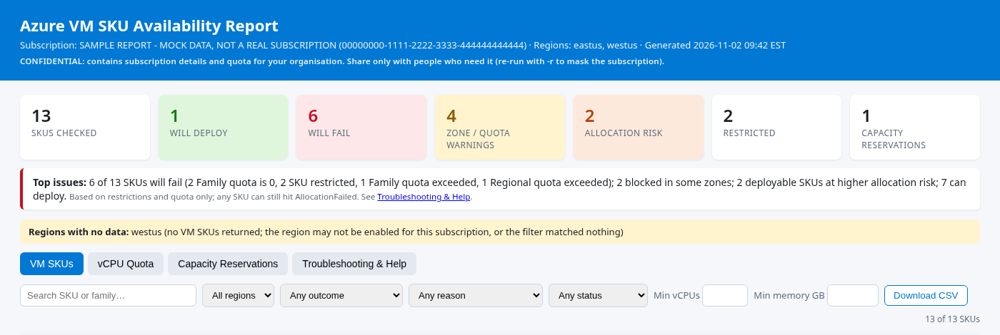
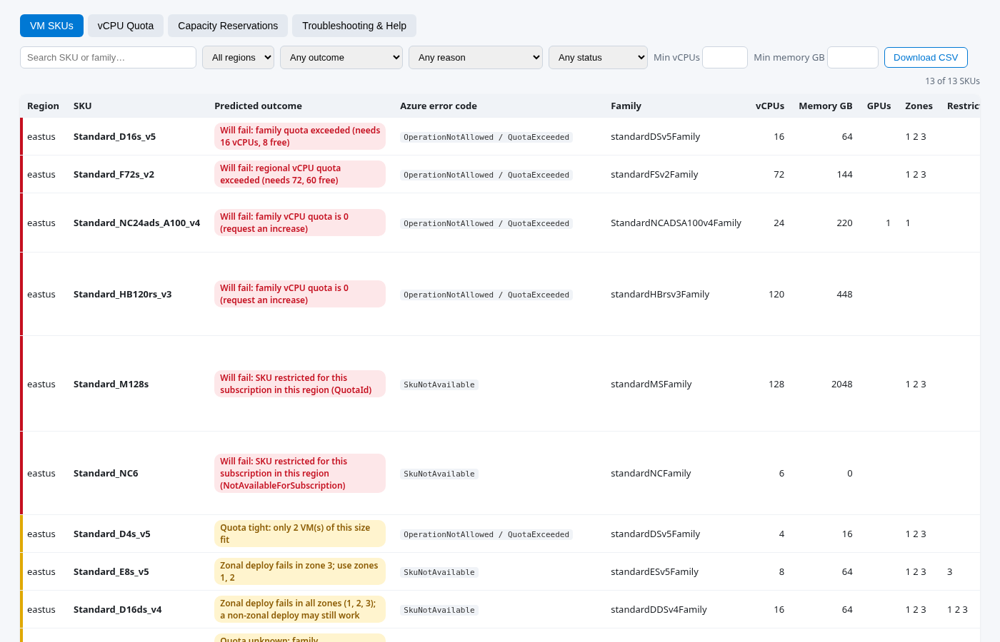
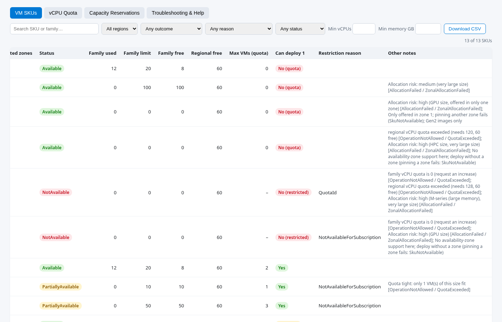
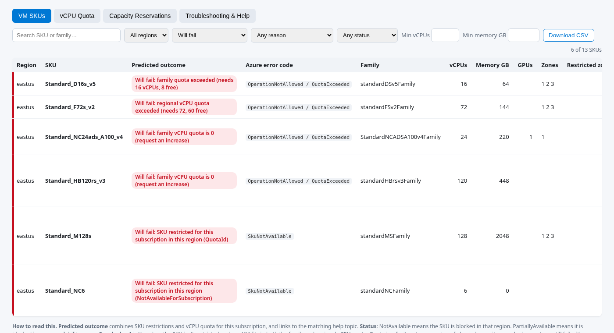
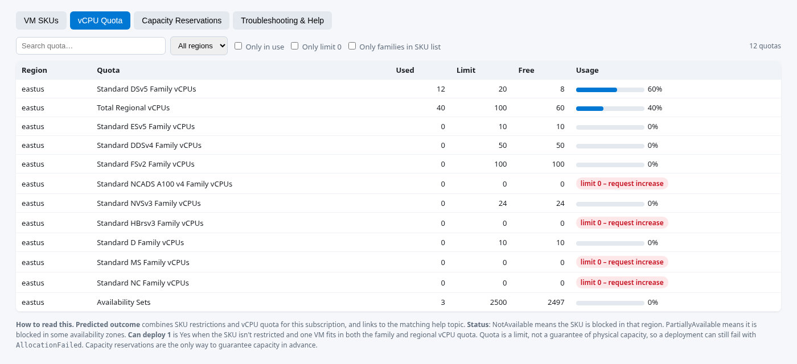
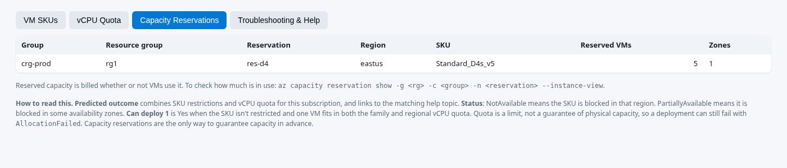
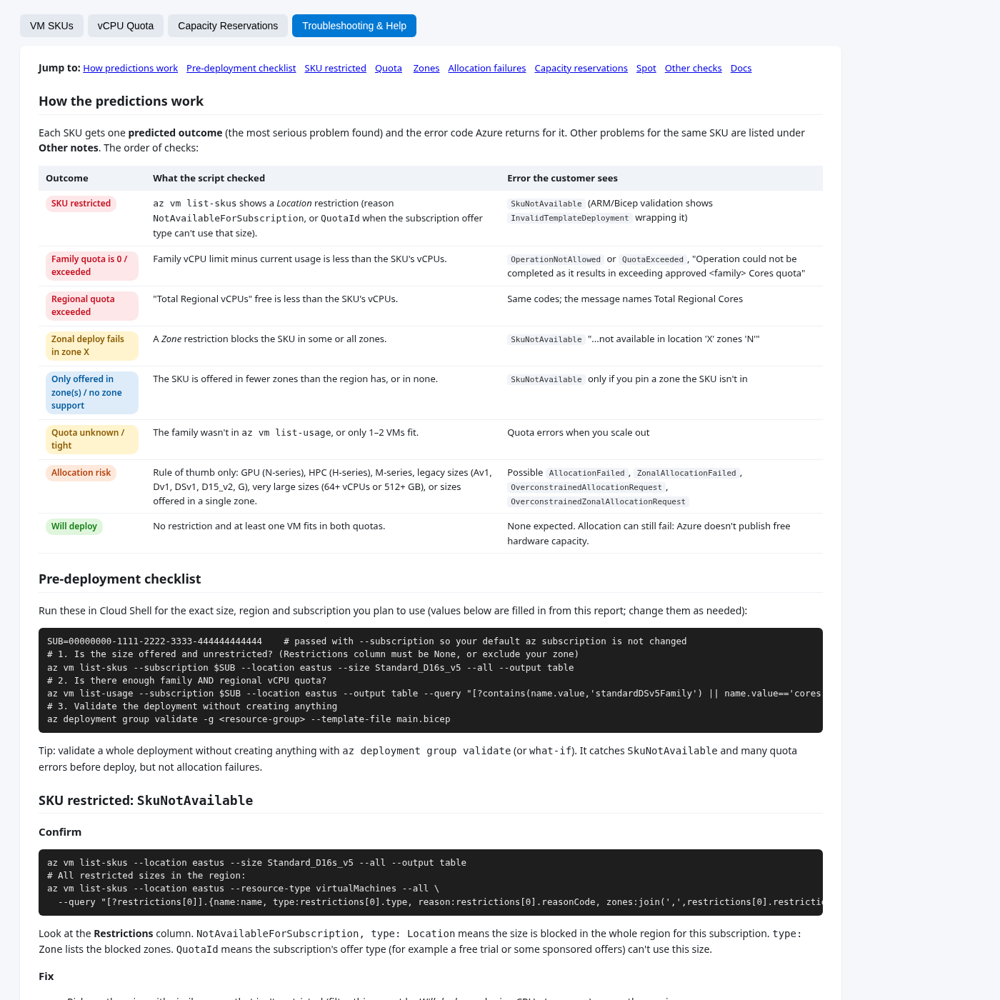

# Sample report walkthrough

[`sample-report.html`](sample-report.html) is a real report produced by `azure-vm-sku-report.sh` v1.2.0. It was generated
against the **mock Azure CLI** in [`../test/mock-az`](../test/mock-az), not a real subscription. Its subscription is named
*"SAMPLE REPORT - MOCK DATA, NOT A REAL SUBSCRIPTION"* and its ID `00000000-1111-2222-3333-444444444444` is fake. The mock
data was chosen so that every kind of result appears at least once. Region `eastus` has 13 SKUs. Region `westus` is
deliberately empty, to show how a region with no data is reported.

This page goes through the report one screenshot at a time: what you see, what it means, and what to do next.

- [Opening the sample](#opening-the-sample)
- [1. Header, summary cards and Top issues](#1-header-summary-cards-and-top-issues)
- [2. VM SKUs tab: predicted outcomes](#2-vm-skus-tab-predicted-outcomes)
- [3. VM SKUs tab: filtered to "Will fail"](#3-vm-skus-tab-filtered-to-will-fail)
- [4. vCPU Quota tab](#4-vcpu-quota-tab)
- [5. Capacity Reservations tab](#5-capacity-reservations-tab)
- [6. Troubleshooting & Help tab](#6-troubleshooting--help-tab)
- [Generating your own report](#generating-your-own-report)

## Opening the sample

GitHub shows `.html` files as source code, not as a web page. To see the report:

- **Download it:** open `docs/sample-report.html` on GitHub, click **Download raw file** (or *Raw*, then *Save as…*),
  then double-click the saved file. It works offline in any modern browser.
- **Clone the repo** and open `docs/sample-report.html` in your browser (`start`, `open` or `xdg-open`).
- **Preview it online** with a raw-HTML preview service. Replace `<owner>`, `<repo>` and `<branch>` with this repository's
  values:
  - `https://raw.githack.com/<owner>/<repo>/<branch>/docs/sample-report.html`
  - `https://htmlpreview.github.io/?https://github.com/<owner>/<repo>/blob/<branch>/docs/sample-report.html`

  These are third-party services. Use them only for this mock sample, **never for a real report**, because real reports
  contain your subscription details.

The report has a strict Content-Security-Policy. If a preview service rewrites the page, some interactive parts
(filters, tabs) might not work there. A downloaded copy always works.

---

## 1. Header, summary cards and Top issues



**Header (blue bar).** Which subscription was checked (name and ID), which regions, and when the report was made (local
time of the machine that ran it). The **CONFIDENTIAL** line is a reminder that real reports show subscription details and
quota. Run with `-r` to mask the subscription before sharing.

**Summary cards** count SKU rows, one per size per region:

| Card | Meaning in the sample |
|---|---|
| **SKUs checked** (13) | Sizes found in the scanned regions after the `-f` filter |
| **Will deploy** (1, green) | No problem at all: `Standard_D2s_v5` |
| **Will fail** (6, red) | Deployment fails before any VM is created (restriction or quota) |
| **Zone / quota warnings** (4, amber) | Works, but only in some zones, with tight quota, or with unknown quota |
| **Allocation risk** (2, orange) | Quota and restrictions are fine, but this kind of size is often short of capacity |
| **Restricted** (2) | Sizes blocked for this subscription in the whole region (`NotAvailable`) |
| **Capacity reservations** (1) | Reservations already in the subscription (see tab 5) |

Cards are counted by the **predicted outcome**, so each SKU falls in exactly one colour. "Restricted" and "Capacity
reservations" are separate counts.

**Top issues** sums up the whole report in one sentence. In the sample: *6 of 13 SKUs will fail* (2 family quota is 0,
2 restricted, 1 family quota exceeded, 1 regional quota exceeded), *2 blocked in some zones*, *2 deployable SKUs at higher
allocation risk*, and *7 can deploy*. "Can deploy" means every SKU that isn't "Will fail" (13 − 6 = 7), including those with
warnings. The smaller note is the key caveat: the report checks restrictions and quota, but any SKU can still hit
`AllocationFailed`, because Azure doesn't publish free capacity.

**Regions with no data (yellow).** `westus` returned no SKUs. In a real run this means the region isn't enabled for the
subscription, the `-f` filter matched nothing there, or the query failed (the error text is shown). Check the region name,
then run `az vm list-skus -l westus -o table` yourself.

**What to do next:** if *Will fail* is above 0, open the VM SKUs tab and filter on it (screenshot 3).

## 2. VM SKUs tab: predicted outcomes



One row per size per region. The coloured bar on the left and the **Predicted outcome** badge show the most serious
problem found for that size:

| Colour | Outcome group | Meaning |
|---|---|---|
| Red | **Will fail** | Restricted, or not enough vCPU quota. Azure rejects the deployment. |
| Amber | **Warning** | Fails in some zones, quota fits only 1–2 VMs, or quota is unknown |
| Orange | **Allocation risk** | Should pass the checks, but capacity is often short for this kind of size (GPU, HPC, M-series, legacy, very large, single zone) |
| Blue | **Deploys, zone notes** | Works, but only in some zones or without zone support |
| Green | **Will deploy** | No issue found |

**Reading an outcome.** Examples from the sample, from top to bottom:

- `Standard_D16s_v5` – *Will fail: family quota exceeded (needs 16 vCPUs, 8 free).* The DSv5 family has 20 vCPUs, 12 of
  them in use, and one VM needs 16. Azure returns `OperationNotAllowed` / `QuotaExceeded`. **Fix:** request at least 28 for
  DSv5 in eastus, or free up 8 vCPUs.
- `Standard_F72s_v2` – *Will fail: regional vCPU quota exceeded (needs 72, 60 free).* The family has room, but the
  **Total Regional vCPUs** quota doesn't. Both limits must fit. **Fix:** raise the regional quota.
- `Standard_NC24ads_A100_v4`, `Standard_HB120rs_v3` – *family vCPU quota is 0.* New subscriptions start at 0 for GPU and
  HPC families. **Fix:** request quota for that family.
- `Standard_M128s` – *SKU restricted (QuotaId).* This subscription's offer type can't use the size. `Standard_NC6` –
  *restricted (NotAvailableForSubscription).* The size is blocked for this subscription in this region. Both give
  `SkuNotAvailable`. **Fix:** choose another size or region, or open a support request to enable it.
- `Standard_D4s_v5` – *Quota tight: only 2 VMs fit.* Fine for one VM, but scaling out will fail.
- `Standard_E8s_v5` – *Zonal deploy fails in zone 3; use zones 1, 2.* `Standard_D16ds_v4` – blocked in all zones. A
  non-zonal deployment may still work.

**Azure error code** is the code the customer would see. Click the outcome badge to open the matching help section.

The table is wide. Scroll right for the quota columns:



| Column | Meaning |
|---|---|
| Zones / Restricted zones | Zones where the size is offered / zones blocked for this subscription |
| Status | `Available`, `PartiallyAvailable` (some zones blocked), `NotAvailable` (blocked in the region) |
| Family used / limit / free | vCPU quota of the size's family in that region |
| Regional free | Free **Total Regional vCPUs** |
| Max VMs (quota) | How many VMs of this size fit within the smaller of the two quotas (– when restricted) |
| Can deploy 1 | Yes / No (quota) / No (restricted) / Unknown |
| Restriction reason | `NotAvailableForSubscription` or `QuotaId` |
| Other notes | Further issues for the same size, each with its error code. For example `Standard_HB120rs_v3` *also* exceeds the regional quota and is high allocation risk, so fixing the family quota alone isn't enough. |

**Filters** (top row): text search on SKU or family, region, **outcome**, **reason** (for example *Family quota is 0*),
restriction status, and minimum vCPUs and memory. Click any column header to sort. **Download CSV** exports the rows that
match, ready for Excel. Values starting with `=`, `+`, `-` or `@` are made safe.

## 3. VM SKUs tab: filtered to "Will fail"



Choose **Will fail** in the *Any outcome* list. The counter changes to **6 of 13 SKUs**, and only the red rows remain.
This is the list to fix before deployment. Two groups stand out:

- **Quota** (`OperationNotAllowed` / `QuotaExceeded`): `D16s_v5`, `F72s_v2`, `NC24ads_A100_v4`, `HB120rs_v3`. Request
  quota (portal **Quotas > Compute > New Quota Request**, or `az quota update`). Most requests are approved automatically.
- **Restricted** (`SkuNotAvailable`): `M128s`, `NC6`. Choose another size or region, or open a support request
  (*Service and subscription limits (quotas)*).

Other useful filters:
- *Deployable (not fail)* lists the options that work today.
- *Reason* narrows the list to one kind of problem.
- *Region* compares regions when you scanned more than one.

(The filter isn't saved in the URL. The screenshot was made by selecting it in a temporary copy of the page.)

## 4. vCPU Quota tab



Every vCPU quota row Azure returned for each region (`az vm list-usage`):

- **Used / Limit / Free:** vCPUs in use, the approved maximum, and what's left.
- **Usage bar:** blue below 80%, red at 80% or more.
- **`limit 0 – request increase`:** the family has no quota at all. In the sample that's NCADS A100 v4, HBrsv3, MS and NC.
  These are the families behind the "quota is 0" failures.
- **Total Regional vCPUs:** the ceiling for the whole region (40 of 100 used, 60 free). Every VM must fit in its family
  quota **and** in this one.

Filters: *Only in use*, *Only limit 0* (quick list of quota to request), and *Only families in SKU list* (hides families
unrelated to the scanned sizes). Deallocated VMs don't use vCPU quota, but VMs that are only stopped do.

## 5. Capacity Reservations tab



Existing **on-demand capacity reservations** in the subscription. The sample has group `crg-prod` in resource group
`rg1`, reserving **5 × Standard_D4s_v5 in eastus zone 1**. A reservation is the only way to *guarantee* capacity in
advance. It's billed whether or not VMs use it, so check how much is used with the command shown under the table. If a
size you need shows *Allocation risk*, consider a reservation for it. Run with `-x` to skip this lookup (and to keep
reservation and resource-group names out of a shared report).

## 6. Troubleshooting & Help tab



The tab is built into the report, so it works offline. From the top:

1. **How the predictions work:** the order of checks and the error code for each outcome (the same table as in the README).
2. **Pre-deployment checklist:** commands to copy, already filled in with a size, region and subscription from the report:
   check the size is offered and unrestricted, check family and regional quota, then validate the deployment without
   creating anything (`az deployment group validate`). Any value that doesn't look like a normal Azure name becomes a
   placeholder such as `<vm-size>`.
3. **One section per failure type:** SKU restricted (`SkuNotAvailable`), quota (`OperationNotAllowed` /
   `QuotaExceeded`), zones, allocation failures (`AllocationFailed`, `ZonalAllocationFailed`, `Overconstrained…`),
   capacity reservations, Spot, and other checks (Gen1/Gen2 images, accelerated networking, disks). Each section has a
   **Confirm** step (a command that proves the cause) and a **Fix** step (portal path or CLI).
4. **Docs:** links to the Microsoft Learn pages.

The whole tab in one image: [screenshots/07-troubleshooting-help-full.png](screenshots/07-troubleshooting-help-full.png).

---

## Generating your own report

In **Azure Cloud Shell (Bash)**, signed in as a user with at least **Reader** on the subscription:

```bash
git clone <this-repo-url> && cd <repo-folder>
chmod +x azure-vm-sku-report.sh
./azure-vm-sku-report.sh -l "eastus westeurope" -o my-report.html     # add -s <subscription> -f "Standard_D" as needed
download my-report.html                                                # Cloud Shell: save it to your PC, then open it
```

Add `-r` (and `-x`) for a copy you can share outside your team. Don't commit real reports; `.gitignore` already ignores
`*.html` outside `docs/`. See the [README](../README.md#usage) for every option.

To rebuild this sample offline, without Azure:

```bash
mkdir -p /tmp/mockbin && ln -sf "$PWD/test/mock-az" /tmp/mockbin/az
PATH=/tmp/mockbin:$PATH MOCK_SUBNAME="SAMPLE REPORT - MOCK DATA, NOT A REAL SUBSCRIPTION" \
  ./azure-vm-sku-report.sh -l "eastus westus" -o docs/sample-report.html
```

The screenshots were taken with headless Chrome at 1400 px width, using temporary copies of the sample. A small script
in each copy switched tabs, set the outcome filter or scrolled the table, and hid the header on the tab shots. Those copies
aren't part of the repository, and the shipped report is unchanged.
